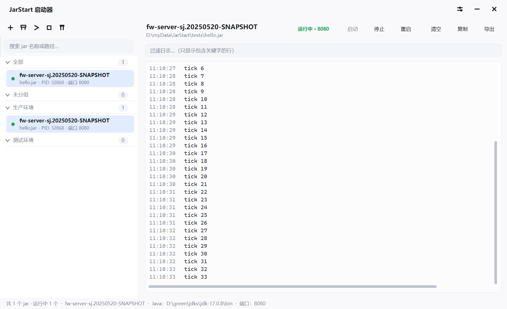
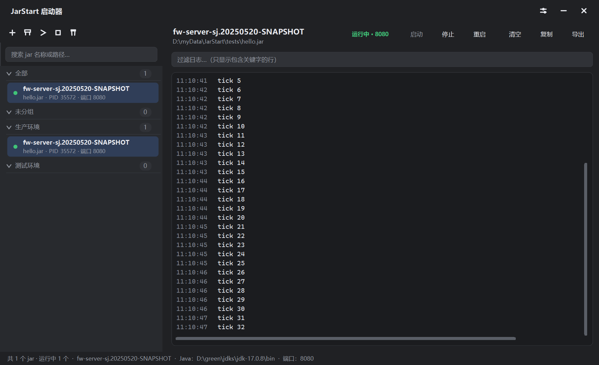
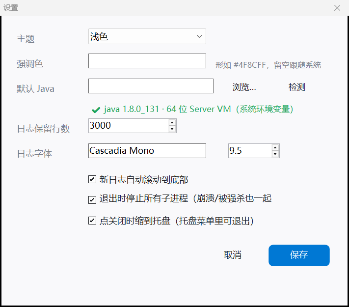

# JarStart — Win11 风格的 jar 包启动器

一个 Windows 桌面小工具：左边管理 jar 包（添加、分组、启动/停止/移除），右边实时显示选中 jar 的运行日志。

界面沿用 [LiteTrans](https://github.com/) 的做法：**C# WinForms + 全部控件自绘**，用 Windows 自带的
`csc.exe` 编译，不需要安装 Visual Studio 或 .NET SDK，双击 `JarStart.exe` 即可运行。







## 功能

| 左侧 | 右侧 |
| --- | --- |
| 添加 jar（多选，或直接把 jar / 文件夹拖进来） | 选中 jar 的实时日志（stdout 灰色、stderr 红色、启动器提示蓝色） |
| 分组：新建 / 重命名 / 删除 / 把 jar 移进移出分组 | 关键字过滤日志 |
| 启动 / 停止 / 重启 / 强制结束进程树 | 清空、复制、导出为文件 |
| 搜索（按名称或路径过滤） | 状态徽章（运行中 / 已退出 / 启动失败）+ PID + 端口 |
| 移除 jar（只从列表移除，不删文件） | 自绘滚动条，浅色/深色主题一致 |

其它：

- **Java 环境**：默认用系统环境里的 `java`（先找 `JAVA_HOME`，再找 PATH）；每个 jar 可以单独指定
  JDK 目录或 `java.exe` 完整路径，对话框里点「检测」会执行 `java -version` 显示版本；
  全局设置里的「默认 Java」同样有「检测」按钮。
- **日志只存在内存里**：每个 jar 保留最近 N 行（默认 3000，可在设置里改），重启启动器后清空；
  需要留档时用「导出」手动存成文件。
- **单 jar 配置**：显示名、jar 路径、所属分组、Java 环境、JVM 参数、程序参数、工作目录、
  环境变量（`KEY=VALUE` 一行一条）、日志编码（UTF-8 / GBK）、端口、是否随启动器自动启动。
- **端口自动识别**：启动后从子进程输出里认出它监听的端口（Tomcat / Undertow / Netty 的
  `started on port(s): 8080`、`started at http://localhost:8080` 等常见写法），识别到会在
  左侧列表、右侧标题栏和底部状态栏显示；识别不到时用「编辑配置」里手填的端口。
- **缩到托盘**：点窗口右上角的关闭只是缩到系统托盘（可在设置里关掉这个行为）。
  托盘图标双击恢复窗口，右键菜单里有「显示主窗口 / 启动全部 / 停止全部 / 设置… / 退出」。
  第一次缩到托盘时会弹个气泡告诉你怎么找回窗口、怎么真正退出。
- **子进程跟着启动器活**：设置里勾上「退出时停止所有子进程（崩溃/被强杀也一起结束）」后，
  启动的 jar 会被登记进 Windows 的 Job Object——正常关窗口会先停掉它们，
  启动器崩溃或被任务管理器强杀时，Windows 也会顺手把它们一起结束，不会留下孤儿进程。
  取消勾选则相反：退出时会问你要不要停，选「否」它们就继续在后台跑。
- **主题**：跟随系统 / 浅色 / 深色，强调色默认取 Windows 系统强调色。
- **高 DPI 自适应**：字体按磅写（系统自动缩放），控件位置尺寸按当前显示器的缩放比例换算，
  100% / 125% / 150% 下都不会出现文字被截断、控件被挤扁；窗口拖到另一块不同缩放的屏幕也会重新排版。
- 关闭窗口时如果还有 jar 在跑，会询问是否一并停止。

## 快捷键

| 按键 | 作用 |
| --- | --- |
| `F5` | 启动选中的 jar |
| `F6` | 停止选中的 jar |
| `F7` | 重启选中的 jar |
| `Delete` | 从列表移除选中的 jar |
| `Ctrl+F` | 定位到搜索框 |
| `↑` `↓` / `Enter` | 在列表中移动 / 启动 |
| `Ctrl+A` / `Ctrl+C` | 日志全选 / 复制（日志区里） |

## 编译

```bat
build.cmd            :: 或直接跑 powershell -File build.ps1
```

只依赖 Windows 自带的 .NET Framework 编译器：

```
%WINDIR%\Microsoft.NET\Framework64\v4.0.30319\csc.exe
```

> 编译器只支持 **C# 5**，源码里不要用字符串内插、`nameof`、表达式体成员这些新语法。
>
> 真正的编译逻辑放在 `build.ps1`（UTF-8 带 BOM），`build.cmd` 只是个 ASCII 包装脚本——
> 这样在英文区域设置的 CI runner 上也不会因为 ANSI 码页不同而解析失败。

产物：

- `JarStart.exe` — 主程序
- `tests\SelfTest.exe` — 核心层自检（配置序列化、日志缓冲、java 解析、端口识别、进程启停）
- `tools\IsolatedUi.dll` — 界面自检用的辅助库

## GitHub Actions

| 工作流 | 触发 | 做什么 |
| --- | --- | --- |
| `.github/workflows/ci.yml` | 推送到 `main` / 提 PR / 手动 | 编译 + 跑核心自检 |
| `.github/workflows/release.yml` | 推 `v*` tag / 手动触发 | 编译 + 自检 + 打包 zip（含 SHA256）+ 自动创建 Release |

用法：

```powershell
git tag -a v0.2.0 -m "v0.2.0"
git push origin v0.2.0        # 触发发布
```

也可以在 Actions 页面手动触发 `打包发布`，填版本号（留空则用 `v0.0.0-dev-<commit>`）。

Release 里会有 `JarStart-<版本>.zip`（JarStart.exe + README）和对应的 `.sha256` 校验文件。

## 自检

```bat
tests\make-test-jar.cmd     :: 用本机 JDK 生成一个会持续打印日志的测试 jar
tests\SelfTest.exe          :: 跑一遍核心逻辑自检
powershell -File tools\uitest.ps1   :: 跑一遍界面自检（窗口在屏幕外，全程用消息驱动）
```

`SelfTest.exe` 会自己用 `javac`/`jar` 生成一个测试 jar，启动它、检查日志是否被捕获、再把它停掉。

`tools\uitest.ps1` 是界面自检：它把程序窗口放到**屏幕外**（配置里的 `WinX` 用负数），
再用 `PostMessage` 发消息驱动控件，**不会移动你的鼠标、也不会抢焦点**，可以放心跑。
它会验证：启动 jar 后状态变成「运行中 · 端口」、点关闭后窗口隐藏但程序还在、托盘菜单的「退出」能真正退出。

### 自动化测试用的环境变量

| 变量 | 作用 |
| --- | --- |
| `JARSTART_CONFIG_DIR` | 把配置文件放到指定目录，不污染 `%APPDATA%` |
| `JARSTART_NO_TRAY` | 不往系统托盘放图标（测试时任务栏不留痕迹） |
| `JARSTART_NO_REPOSITION` | 不把窗口拉回屏幕中央（测试时窗口保持在屏幕外） |
| `JARSTART_SHOW_TRAY_MENU` | 反复弹出托盘菜单，方便脚本点菜单项 |

## 配置存放位置

`%APPDATA%\JarStart\config.json`

包含 jar 列表、分组、各 jar 的启动参数和外观设置。日志**不写盘**，只在内存里。
异常日志在 `%APPDATA%\JarStart\crash.log`。

## 目录结构

```
build.cmd              一键编译
src/
  Program.cs           入口：单实例、DPI 感知、异常兜底
  Theme.cs             Win11 配色（浅色/深色 + 强调色）
  Native.cs            DWM 圆角 / 深色标题栏 / 系统深色与强调色
  UiKit.cs             FlatBtn / Card / IconBtn / LineEdit / 右键菜单 / 输入弹窗
  AppIcon.cs           运行时绘制图标 + 圆角等绘图工具
  Models.cs            JarItem / LogLine / JarStatus 等数据模型
  AppConfig.cs         全局配置与 JSON 持久化
  LogStore.cs          每个 jar 的内存环形日志缓冲
  JdkResolver.cs       解析 java 路径、读版本号、扫描本机 JDK
  JavaProbe.cs         「检测」按钮的共用逻辑（版本号显示 + tooltip）
  ProcessManager.cs    启停进程树、捕获 stdout/stderr、状态机
  PortDetector.cs      从启动日志里识别端口号
  JobGuard.cs          Job Object：让子进程跟着启动器一起结束
  TrayIcon.cs          系统托盘图标与托盘菜单
  Ui.cs                DPI 缩放系数（布局用的像素值统一从这里换算）
  JarTreePanel.cs      左侧自绘分组树
  LogView.cs           右侧自绘日志视图（含自绘滚动条）
  LogPanel.cs          右侧面板（工具条 + 过滤 + 日志）
  JarEditForm.cs       单个 jar 的配置对话框
  SettingsForm.cs      全局设置
  MainForm*.cs         主窗口（结构 / 布局 / 逻辑）
  app.manifest         声明 PerMonitorV2 高 DPI 感知（由系统加载时生效）
tests/                 测试 jar 脚本与核心自检
tools/                 界面自检工具（隔离桌面 + 消息驱动，不抢鼠标）
shots/                 界面截图
```

## 已知限制

- 只支持 Windows（用到 Win32 的 DWM 圆角、深色标题栏等接口）。
- 「移除」只是从启动器列表移除，不会删除磁盘上的 jar 文件。
- 端口靠启动日志里的关键字推断（Tomcat/Undertow/Netty 那些标准写法），个别服务如果打印得
  很不常规就识别不出来，这时可以在「编辑配置」里手填端口。端口不会去探测占用情况。
- 子进程如果自己再拉起子进程，停止时会用 `taskkill /T` 一起结束整棵进程树。
